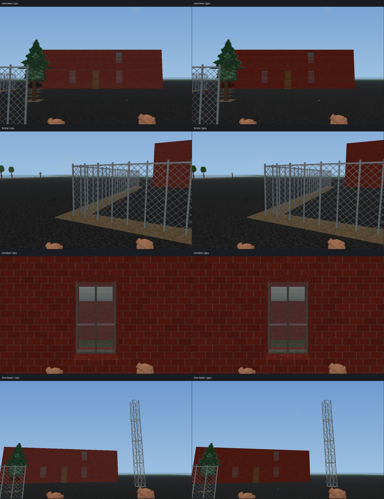
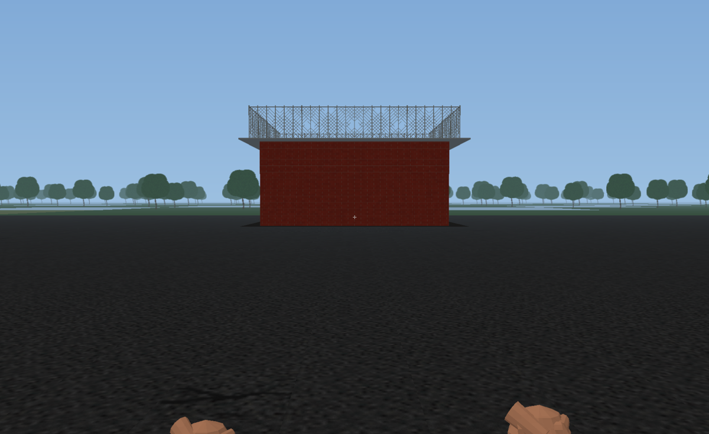

# First Person View 0.12.x stabilization

Baseline: `c5a0a0a5e12991df06ba000f80dd359f274b7f50` (merged PR #205).
Engine pins remain 1040 `3f7fb352bf492ba521bd9408a0c9f6ce239e8d83`
and 1807 `074aa98bd5be3de4c35f154082db32a0e63bb0f1`.
Scope: gameplay audit, measured performance, camera/interaction stability,
visual polish, depth-driven surface submission and cached horizon LOD.
No gameplay rules are changed.

## 0.12.7 physical geometry and continuous first-person architecture

Rendering source: `2144004c83c4c8de59efa42da49f4d2dfbdb28ea`, tree
`92f8f9d072612bcb317507eae3afc2cd3d885e41`. Packaged test merge
`4ea4e39e0d6288e0ab8ca4cf62f19c36f0ff4386` has the identical tree.
[Native qualification](https://github.com/Neversalimus/NCMM/actions/runs/38989457205)
qualified both pinned engines; final artifacts and hashes are recorded below.
Windows and Linux passed 25 module/renderer tests each, eight atomic source
transform tests and four focused ASan/UBSan tests. The independent
[GPU device/UI workflow](https://github.com/Neversalimus/NCMM/actions/runs/38989457173) passed.

| Build | Workflow artifact | Installer ZIP SHA256 |
| --- | ---: | --- |
| 1040 | 12085194422 | `a4133d2329b1fe257e82d3021335349054b2544c547c9d0cc3a4f04766d2866f` |
| 1807 | 12086902922 | `268448d4ba69ab5b35d9358add1051b043685793c68a6602f2e28b092c3cf51d` |

The first 1807 focused smoke-GPU process exited with `0xC0000005` (job
117269267640). The targeted identical-source retry (job 117281375007) passed all
native gates. The earlier root cause remains unestablished; no root-cause fix
is claimed. The workflow follow-up retains focused-process evidence on failure
for future diagnosis. The separate 1040 RTX 4090 smoke/creature profile passed.

All 32 payload files, Setup, Host, module, source merge and workflow identity
were independently verified for each archive. The exact measured 1040 candidate
and final qualified ZIP are byte-identical. 1807 hardware timings are unmeasured.

Building surfaces now retain real terrain identity/material/orientation before
ordinary 2D discovery. The first-person shell uses physical sight range and
raster occlusion, while contents, actors and interaction keep native perception
and exact 3D occlusion. This does not change top-down discovery or game terrain.
Chain-link panels use all four physical neighbours, including mesh gates and
L/T junctions. Native radio-tower cells become open steel storeys. Ground tower
foundations keep their real floor; elevated lattice and treetops do not acquire
full slabs. Treetops use foliage-only alpha art, so a 2D atlas log fallback cannot
become a large opaque rectangle. Ground loot is a top-facing supported cutout;
unsupported air items are omitted. Window semantics take priority over inherited
door flags, and a curtain-close action alone cannot make a closed window open.

The distant forest uses four grounded leafy impostors with eight triangles per
24-map-square patch, preserving the former geometry budget. The mesh stays
cached during turns. A full 31×31 forest remains below 3 MiB of geometry.
Flat terrain skips oriented-neighbour work; material semantics are cached
separately for ground and elevated partial supports. No shader change was made.

The native movement diagnostic adds four actual terrain/loot views, each
captured in CPU and GPU modes: facade/inventory overview, connected fence corner
and closed gate, domestic window with an adjacent actual door, and a tree with
upper foliage beside four real tower levels. Snapshot checks assert the native
shapes, lack of full upper support slabs, supported items and hidden contents.
All eight clear packaged 1040 captures were visually inspected. This caught and
rejected an earlier log-texture candidate before delivery. The supplied user
images guided the fixtures; no original user save was available.



### Exact packaged hardware results versus 0.12.6

The final 1040 binaries were measured on RTX 4090 / Direct3D 12 in clear and
controlled native-rain clones with identical 107 actual UDP Hybrid v3 assets.
The report retains every raw sample and all binary/source identities. Each run
has 12 records: three scenes, CPU/GPU and 640×480 / 1768×1084 viewports. Each
record has twelve native steps and two 48-angle sweeps. Fresh Balanced defaults
cap the internal raster at 1280×800. No other game ran during these timings.

The following values use the 1768×1084 viewport, in milliseconds. First render
excludes the preceding native move/refresh; move-to-ready includes both.

| Weather | Scene | 0.12.6 first render median / p95 | 0.12.7 first render median / p95 | 0.12.7 move-to-ready median / p95 | 0.12.7 warm rotation median / p95 |
| --- | --- | ---: | ---: | ---: | ---: |
| clear | street | 20.64 / 34.06 | 20.86 / 36.71 | 45.01 / 69.90 | 13.55 / 15.51 |
| clear | multi_level_horde | 21.66 / 36.64 | 19.74 / 28.45 | 38.02 / 54.84 | 12.11 / 15.54 |
| clear | city_blocks | 21.65 / 29.53 | 23.22 / 35.19 | 46.02 / 66.67 | 13.93 / 16.58 |
| rain | street | 20.94 / 34.39 | 19.19 / 31.56 | 37.41 / 57.31 | 12.56 / 13.64 |
| rain | multi_level_horde | 18.87 / 31.18 | 18.59 / 29.59 | 38.30 / 55.58 | 12.19 / 13.67 |
| rain | city_blocks | 20.26 / 32.05 | 20.10 / 32.06 | 45.35 / 66.27 | 14.47 / 16.35 |

The 15 ms first-render target is not met: 23 of 144 GPU first-step samples are
at or below 15 ms, and no full-size scene median or p95 meets the target. No universal
speedup is claimed. Clear dense-city first-render median increased from 21.65
to 23.22 ms; its warm-rotation median changed from 14.31 to 13.93 ms. These are
one-run wall-clock measurements, and small changes can reflect run variation.
The controlled movement routes advance zero ordinary AI turns. They do not
qualify native AI/combat latency or a manual playthrough. The existing Windows
compressed-save path limit recorded for 0.12.6 is unchanged by this work.



An additional exact packaged 1040 run on RTX 4090 passed all four focused
smoke-gas / one-creature CPU/GPU cases, 96 frames each, with exclusive phase
accounting and no GPU-to-CPU fallback. This does not establish the cause of the
earlier 1807 CI access violation.

See [the complete native geometry report](qualification/0.12.7-native-geometry.json).

## 0.12.6 first-frame extraction and distant horizon

Rendering C++ revision: `21a4ffe577badb2e90cf7519c2c5f2b48350c7eb`.
Qualification head: `25d0f54b3ac6eb1a1ea70967eff15fadb629b08d`; packaged test
merge `5fb6c0e612563ec7b2b67ef58277858a933f8c9d` has the identical tree
`fa02ef488515a2a11ec6291dafb3ae6cc6e188f0`.
[Native integration and installer qualification](https://github.com/Neversalimus/NCMM/actions/runs/38964735690)
passed for 1040 (attempt 1, job 117190520446) and 1807 (attempt 2, job
117203626757). Both exact official graphics and sounds packages passed installer
transactions, recovery and long-path checks; each pin completed four actual
bootstrap launches, two fast multi-Z save/load checks, native gameplay and its
60-second CI soak, the focused four-case frame profile and twelve movement/
rotation records including 1768×1084. Each final archive independently verified
all 32 payload hashes and matched its printed native release proof.

Windows and Linux each passed 25 renderer/module tests and eight atomic
source-transform tests. Four focused cache/facade tests passed ASan/UBSan.
The separate Windows/Linux GPU device/UI qualification passed. These CI adapter
timings are not hardware FPS claims. The final installer identities are:

| Build | Workflow artifact | Installer ZIP SHA256 |
| --- | ---: | --- |
| 1040 | 12076201053 | `f5db27a76daa13a60265dd4f66ec8e7e51d358a96bfef4efffcb015259d683e1` |
| 1807 | 12077247812 | `a63e02e4319e487c603ca785fe84a0977c4d8965e9a107217741791eaa086dee` |

The exact timed 1040 candidate and final qualified artifact are byte-identical.
The JSON report records Host, module, Setup and outer-artifact SHA256 values.
The measured first-rendered-frame target of 15 ms is not met.

Static walls and real slab faces now submit physical geometry for raster depth
occlusion. The previous path traced five samples for each wall/slab after a
native step and could still miss a visible opening between samples. Native
perception plus exact 3D body occlusion continue to gate creatures, loot, fields,
furniture and interaction targets. Roof-column derivation is lazy; empty weather
air is limited to radius 16 and the eye level through two levels above it.

Hardware qualification rejected an earlier candidate before delivery: its clear
1768×1084 first-render medians were 71–82 ms versus 45–50 ms in 0.12.5. The
raster path had admitted buried surfaces whenever an unrelated distant opening
prevented a whole-plane seal. Cached summed-area tables now prove the complete
XY rectangle between each source voxel and both the native/displayed eyes
closed before extracting hidden lower/higher storeys. Open shafts, transparent
slabs and bounds outside the source window fail the proof. Tall/airborne
entities retain their native/body path. The nearest upper storey remains for
its real underside. Frustum and local empty-air rejection precede native light
queries. Prefix storage is bounded below 2 MiB for all 32 maximum-size planes,
and contributes to source-cache accounting. Tests enumerate rectangles around
a shaft, check glass/revisions/world shifts/bounds and compare closed proofs
against exact 3D rays from noncentral eyes to complete cell corners.

An optional, size-gated multilevel minor-1 getter publishes separate horizon
patches from already resident, discovered overmaps. The 31×31 overmap window
uses 24-map-square patches and a hard 2048-patch bound. Discovered forest/water/
road/field and selected building types become approximate silhouettes. Unknown
geography has neutral ground only, with no objects or heights. The source does
not load, generate or discover overmaps for rendering. Underground and
blind/very-short-sight views disable this layer.

Exact subtraction removes the near 97×97 square from the horizon. Coarse
features stay beyond its boundary and cannot fill a nearby shaft. CPU and GPU
share depth geometry. One retained opaque GPU mesh is independent of camera
yaw; two geometric forest impostors use eight triangles per patch (ten with
ground). A complete 31×31 forest must remain below 3 MiB, leaving room beside
detailed geometry within the Host's 16 MiB frame upload allowance.

The shader header was actually regenerated by the passing Windows DXIL/Linux
SPIR-V device workflow, rather than merely updating its source digest. Its
GLSL digest is `1713e8b6e8516fe283049e6ab67b13a28fc40d47770e989f2594478f504f79b4`.
The prototype workflow verifies this identity before module compilation.

Static GPU preparation retains normalized neighbour signatures when the ordered
static contents and layout are unchanged, even after a native revision notice.
World chunks use hashed coordinate lookup. Each immutable renderer image is
prepared once per collect, and a packet retains textures once per unique mesh.
The retained signature vectors contain hashes only, never callback pointers.
Tests verify that changing live light still updates the GPU cell buffer while
unchanged geometry and adjacency stay cached; changed floor permissions still
invalidate neighbouring geometry. Cache memory accounting includes the retained
digest vectors and chunk lookup storage.

The disposable combat audit starts each scripted round standing, with transient
effects cleared and stamina restored, and checks that the native melee cost
cannot open the slow-weapon confirmation.
It records that controlled condition explicitly. Enemy attacks, real native AI
turns and the normal melee/firearm implementations still run. Ordinary player
games retain their native stamina and confirmation behavior; the diagnostic
does not qualify ordinary combat balance.

### Timing definitions and the 0.12.5 comparison

`first_frame_after_step_samples_ms` measures the native draw/presentation after
the step; it excludes `avatar_action::move` and the preceding native refresh.
`first_ready_samples_ms` includes those operations. The 0.12.5 documentation
previously called the latter "first frame". These metrics must not be mixed.

The original 0.12.5 raw frame stream permits extraction of the twelve first
render frames: after the 96 cold/warm angle frames, each native step is the
frame with zero ray-cache hits and a positive ray-cache miss count. Exactly
twelve frames satisfy this condition in every GPU record. Full-size 1768×1084
RTX 4090 baselines are:

| Weather | Scene | First rendered frame median / p95 | Native move to first ready median |
| --- | --- | ---: | ---: |
| clear | street | 44.84 / 61.22 | 55.72 |
| clear | multi_level_horde | 46.58 / 59.02 | 58.83 |
| clear | city_blocks | 49.54 / 58.33 | 61.88 |
| rain | street | 83.07 / 97.81 | 93.76 |
| rain | multi_level_horde | 71.92 / 85.45 | 85.68 |
| rain | city_blocks | 68.10 / 79.96 | 84.89 |

CI times describe the reported CI adapter, including software devices when
present; they cannot establish RTX 4090 performance. The walking diagnostic
advances zero ordinary AI turns and is not a manual playthrough.


### Exact packaged hardware results

The 1040 installer below supplied the exact Host and all bundled DLLs for both
hardware runs. Every payload SHA256 (32 files), Setup executable, release/source
identity and the three changed Host source inputs were independently checked.
First-render time includes the native 2D draw and first-person draw/presentation,
but excludes the preceding native move/refresh. Viewport sizes are 640×480 and
1768×1084 at fresh Balanced defaults; a viewport is not an assertion of internal
raster size. Each weather run includes three scenes, CPU and GPU, twelve native
steps and two 48-angle sweeps per record. All GPU frames used RTX 4090 /
Direct3D 12 without software fallback. Both runs used the same 107 actual
UDP Hybrid v3 assets as the 0.12.5 baseline.

The following tables use the 1768×1084 viewport; values are milliseconds.

| Weather | Scene | 0.12.5 first render median / p95 | 0.12.6 first render median / p95 | Median speedup |
| --- | --- | ---: | ---: | ---: |
| clear | street | 44.84 / 61.22 | 20.64 / 34.06 | 2.17× |
| clear | multi_level_horde | 46.58 / 59.02 | 21.66 / 36.64 | 2.15× |
| clear | city_blocks | 49.54 / 58.33 | 21.65 / 29.53 | 2.29× |
| rain | street | 83.07 / 97.81 | 20.94 / 34.39 | 3.97× |
| rain | multi_level_horde | 71.92 / 85.45 | 18.87 / 31.18 | 3.81× |
| rain | city_blocks | 68.10 / 79.96 | 20.26 / 32.05 | 3.36× |

| Weather | Scene | 0.12.5 move to first ready median / p95 | 0.12.6 move to first ready median / p95 |
| --- | --- | ---: | ---: |
| clear | street | 55.72 / 85.45 | 39.25 / 64.40 |
| clear | multi_level_horde | 58.83 / 83.63 | 43.38 / 68.21 |
| clear | city_blocks | 61.88 / 84.87 | 42.87 / 58.58 |
| rain | street | 93.76 / 122.75 | 40.57 / 59.78 |
| rain | multi_level_horde | 85.68 / 111.36 | 39.65 / 57.65 |
| rain | city_blocks | 84.89 / 111.11 | 46.09 / 66.12 |

| Weather | Scene | 0.12.5 warm rotation median / p95 | 0.12.6 warm rotation median / p95 |
| --- | --- | ---: | ---: |
| clear | street | 14.45 / 15.81 | 13.07 / 15.86 |
| clear | multi_level_horde | 13.14 / 15.05 | 12.65 / 17.14 |
| clear | city_blocks | 9.55 / 11.76 | 14.31 / 19.71 |
| rain | street | 37.06 / 44.65 | 12.98 / 14.75 |
| rain | multi_level_horde | 28.18 / 36.65 | 12.88 / 16.24 |
| rain | city_blocks | 14.31 / 17.50 | 15.01 / 16.41 |

These are improvements to first-frame latency, not a universal rotation gain.
Clear dense-city warm rotation changed from 9.55 to 14.31 ms; rain dense-city
rotation changed from 14.31 to 15.01 ms. None of the scene first-render medians
or p95 values meet 15 ms. Only 17 of the 144 GPU first-step render samples do.
Native-move-to-first-ready includes movement and refresh but these controlled
routes advance no ordinary AI turns. The separate native-action audit includes
controlled real turns and inputs and does not isolate AI calculation time.

The clear and rain hardware runs each passed ordinary-vision facade continuity
(18 connected front-wall cells and supporting slabs), CPU/GPU horizon rendering,
known forests, neutral unknown geography and exact near-square exclusion.
[The scaled horizon capture](qualification/0.12.6-horizon.png) comes from the same
1040 installer. Full numeric streams, identities and limits are retained in
[the native report](qualification/0.12.6-native-horizon.json).

The exact 1040 binaries also passed a separate hardware native-gameplay audit:
ten action groups, 18 real combat turns across 1/5/20-enemy groups, 48 CPU/GPU
gallery cases with the official and actual UDP tilesets, and a 60.03-second
automated soak. The soak rendered 933 frames, toggled F6 14 times and F12 nine
times, loaded the native map three times and saved once. The subsequent
three-Z-level native save/load check passed. Every GPU gallery case used the
RTX 4090 / Direct3D 12. These controlled combat conditions include avatar
protection and stamina/state resets; they do not qualify ordinary balance.

The first audit in the long workspace path failed on native compressed-save
metadata (`content_end`). The same failure reproduced with the exact 0.12.5
Host/DLL. A separate save-only comparison then held the runtime, fixture and
encoded avatar name constant: the generated memory-archive filename was 291
characters in the failing path and 229 in the successful path. The pinned
upstream Windows memory-map open passes a raw native path to CreateFileW and
the zzip stack does not guard a failed optional load. These observations support
a native Windows long-path limitation. The complete hardware audit above passed
after only shortening its output/game path. This is an existing native-path
limit, distinct from the passing installer long-path transaction coverage.
Use a short output folder for native benchmarks; arbitrary native save-path
lengths are not qualified.

### Native crash diagnostics and limits

One earlier 1040 CI attempt at rendering revision `21a4ffe` stopped with
SIGSEGV after both facade captures and before either horizon capture. Its
original backtrace was lost: the upstream crash handler waits for its fatal
modal to close before writing the log, and the watchdog terminated it.
The diagnostic runner now checks only its own child PID, the explicit fatal
dialog title/class and the literal fatal-crash text, closes that owned crash
modal, waits for the log and still fails the test. Ordinary prompts remain
untouched. The candidate archive is preserved before native qualification for
exact local reproduction; that upload is explicitly not a passed qualification.

The unchanged 1040 retry and both exact packaged hardware weather runs passed.
A later 1807 attempt exited with Windows access violation 0xC0000005 during the
focused smoke/gas GPU profile, while its other native gates passed. A targeted
retry at identical source then passed every gate. These earlier crashes remain
unexplained; no root-cause fix is claimed. Their failed attempts and successful
retries are retained in the report. The native audit/runner improvements make
fatal-modal evidence available and preserve candidate bytes for reproduction.

The preview remains experimental and does not update the certified Host feed.
No manual playthrough, driving, ordinary weather selection or prolonged hardware
soak is claimed. 1807 hardware timing was not measured. Controlled combat resets
are diagnostic conditions, not validation of ordinary combat balance.


## 0.12.5 facade continuity and movement

Runtime commit: `478042944d4de33a3e6ff7be451220ed6be4e286`. Test merge
`4de72e5f3cf161e0ce49b8f6abfca54c699617a5` has the identical runtime tree
`e7ab39033af7b56437c395ce14acfdd64ba9238f`.
[Native integration and installer recovery](https://github.com/Neversalimus/NCMM/actions/runs/38916919820)
passed for both engine pins. Recovery checked out that exact source and reused
its compiled Hosts; both new installer bundles then reran the native gates.
The ordinary workflow checkout is restored. Installer ZIPs now have a required
artifact separate from qualification reports, so reports cannot mask a missing ZIP.

All 25 renderer/module tests passed on Windows and Linux, alongside eight atomic
source-transform tests. Focused ASan/UBSan covered coordinates, source/ray caches,
GPU neighbour caches and facade continuity. Both pins passed graphics/sounds
installation, repair, rollback, vanilla restore, repeated bootstrap launches,
two native multi-Z save/load attempts, ten gameplay action groups, six real AI
turns with 1/5/20 enemies, a 60-second soak, focused profiles and 12 movement records.
The optional exhaustive SDL appearance and paired 0.12.0 world gates were not
enabled for this integration run.

The reported detached floors came with missing facade cells. The ordinary-vision
regression now keeps all 18 front-wall cells and their real supporting slabs in
CPU and GPU modes. In the native upper-storey case, wall-cell ambient light is 4,
but its physically exposed neighbour has light 115.889137: the cell fails native
body range/FOV while its exterior remains visible. Face witnesses supply the
exposed-side light and native distance limit only to coarse architecture.
Actual creatures, items and room contents still require native perception.

Covered windows and closed door leaves meet their entire openings. Terrain
surrounds have full wall depth and neighbouring brick/wood/plaster finishes,
with recessed frames. Wall sides meet the physical storey boundary. Covered slab
rims are omitted beneath complete walls and full-width lintels, removing
coplanar concrete/brick flicker. Sparse missing neighbours and stair openings
retain exposed rims. Upper-storey tree art retains its actual elevation.

Ten full-depth reference views have zero sky holes or missing nearer surfaces.
The building fixture drops from 7,908 to 7,098 collected triangles: 360 shared wall
triangles and 450 covered slab triangles are removed. Frame-local indexed XYZ
lookup is shared by appearance/terrain/atmosphere collection and GPU neighbours.
Native body/slab/facade rays read the existing revision-checked geometry cache
with relative coordinates, avoiding repeated absolute conversion and duplicate
bounds checks without allocating another cache. Differential coverage compares
12,000 body/surface rays and 12,000 facade queries with the original lookup path.

### Exact shipped 1040 hardware measurements

Both packaged runners passed, including final F6 restoration. SHA256 checks cover
the installer, Host, DLL and all 32 payload files for each build; the raw report
retains every identity. These measurements use the delivered 1040 Host
`598bc7b2ee7f535f0032b529eaa743e56409a80224f496cf0d7069f9a1ef1ba5`
and module `42fad99b832a83213373ca902214cc4ed651c1d486f9896a4a37b490b9cd1855`.
All 2,000 recorded GPU frames used hardware Direct3D12 on NVIDIA GeForce RTX 4090,
with no renderer fallback. All 107 UDP assets match the successful 0.12.4 baseline.
Every median/p95 was recalculated from its recorded samples.

Full-size viewport: 1768×1084. All times below are milliseconds. Each record uses
48 cold and 48 repeated camera angles plus 12 native position steps and easing.
The route advances zero ordinary AI simulation turns. Rain uses the same owned
native-descriptor fixture documented in the raw data, with unchanged Host/DLL.

| Weather | Scene | Warm median / p95 | Native move to first ready median / p95 | 0.12.4 native-ready median | Easing median |
| --- | --- | ---: | ---: | ---: | ---: |
| clear | street | 14.45 / 15.81 | 55.72 / 85.45 | 95.13 | 16.20 |
| clear | multi_level_horde | 13.14 / 15.05 | 58.83 / 83.63 | 97.32 | 13.52 |
| clear | city_blocks | 9.55 / 11.76 | 61.88 / 84.87 | 89.03 | 12.43 |
| rain | street | 37.06 / 44.65 | 93.76 / 122.75 | 134.06 | 36.45 |
| rain | multi_level_horde | 28.18 / 36.65 | 85.68 / 111.36 | 125.21 | 21.42 |
| rain | city_blocks | 14.31 / 17.50 | 84.89 / 111.11 | 123.93 | 15.97 |

Native-move-to-first-ready medians are 30–41% lower in clear weather and 30–32% lower in rain.
Steady rotation remains broadly similar; the measurements do not establish
ordinary gameplay FPS or AI turn latency. No manual playthrough, driving or
prolonged hardware soak was performed, and 1807 hardware performance was not
measured. The 1807 package passed its native integration gates.

[Raw 0.12.5 samples, diagnostics, hashes and comparisons](qualification/0.12.5-rtx4090-movement.json).
The 0.12.4 evidence below remains historical.

## 0.12.4 camera and movement performance follow-up

Qualified runtime: `c1ad43add41c2d5b583e885d5a702cebc4b4e81b`.
Test merge `0ec75b84d2aa49607975a6069377aea9ba50b507` has the identical runtime
tree. [Native integration](https://github.com/Neversalimus/NCMM/actions/runs/38800352387),
[GPU/UI](https://github.com/Neversalimus/NCMM/actions/runs/38800266254),
[Source/Package Audit](https://github.com/Neversalimus/NCMM/actions/runs/38800266300)
and [targeted ASan/UBSan](https://github.com/Neversalimus/NCMM/actions/runs/38801084536)
passed. The sanitizer branch adds only its workflow to the qualified runtime.

Native sight-range results are memoized for exact float arguments within one
draw; every frame starts fresh. Candidate enumeration retains both native
body/lower-slab ranges. Same-storey rays use the equivalent supercover path,
including corner ties and the general traversal near storey boundaries.
Absolute-coordinate derived geometry and roof facts retain their overlap after
a viewport shift. Native geometry notifications, loaded-Z bounds and realm
changes still invalidate dependent facts. A plane is considered sealed only
when every source-window tile has a full opaque slab; any opening or glass
defeats the proof. The nearest upper slab underside and avatar storey remain.

GPU neighbour signatures use a bounded frame-local index of the validated sparse
XYZ scene. Auto selects CPU for software adapters; explicit GPU remains available
for qualification. It is substantially slower on the CI software adapter.

Cold-step profiling then identified up to 112908 source-fact rebuilds on the
12-step route, with seven geometry revisions. Definition flags and shape
classification now use a bounded draw-local terrain/furniture memo. Both pinned
engines implement map::has_flag as terrain OR furniture after bounds checking.
The no-Z/bottom floor policy is part of the key. Fields, furniture presence,
vehicles and roofs are evaluated live outside this memo. Recorded frames have
at most 40 definition evaluations and up to 112905 memo hits. Collision tests
recompute exact results; no definition identity survives a draw.

Both pinned Hosts passed graphics/sounds installation, repair, rollback, Restore
Vanilla, repeated bootstrap launches and native multi-Z save/load. Native gameplay
passed all ten action groups, six AI turns with 1/5/20 enemies, official and
actual UDP CPU/GPU scenes, a 60-second automated soak, focused profiles and all
12 movement records per pin. Windows/Linux each passed 24 module tests and eight
atomic source-transform tests. Three focused Linux ASan/UBSan tests passed on
the final cache/traversal/index code. This integration does not repeat the
historical full gallery, paired 0.12 image matrix or 30-minute soak.

### Recorded CI movement

These are CPU wall milliseconds through SDL presentation at a requested
1768×1084 viewport. The CPU renderer uses its existing resolution cap. First-ready
includes the native move/cache update and first presentation; easing and rotation
do not advance simulation turns. Each first-ready row has 12 samples.
Before is checkpoint `a85824f3`; After is the qualified definition-memo runtime.
These are independent CI runs, not a paired same-machine experiment or a
general player-FPS guarantee.

| Pin | Scene | First median before | First median after | First p95 after | Warm rotation median | Easing median |
| --- | --- | ---: | ---: | ---: | ---: | ---: |
| 1040 | street | 99.36 | 67.92 | 100.70 | 34.69 | 29.92 |
| 1040 | multi_level_horde | 102.62 | 74.79 | 92.77 | 35.52 | 31.23 |
| 1040 | city_blocks | 110.82 | 82.77 | 98.78 | 39.92 | 33.59 |
| 1807 | street | 206.68 | 176.31 | 207.69 | 57.37 | 47.02 |
| 1807 | multi_level_horde | 209.02 | 170.55 | 205.45 | 60.39 | 49.03 |
| 1807 | city_blocks | 213.48 | 181.73 | 223.00 | 69.52 | 53.87 |

Explicit GPU cases identify Microsoft Basic Render Driver, a software adapter.
Their full-size warm-rotation medians remain 91–314 ms across the scenes/pins.
Auto selects CPU on that adapter. These CI measurements do not establish discrete-GPU
performance. Separate exact-installer 1040 hardware measurements follow below;
ordinary manual gameplay and 1807 hardware performance remain unqualified.

### Exact 1040 installer on RTX 4090 (2026-10-16)

The exact delivered 1040 Host and DLL completed the packaged movement runner on
NVIDIA GeForce RTX 4090, Direct3D12, actual UDP Hybrid v3, in clear weather and a
native rain-descriptor fixture. All 32 payload hashes and Setup were verified
before extraction; the tested clone's Host/DLL hashes match the delivery hashes
below. [Raw samples and provenance](qualification/0.12.4-rtx4090-movement.json)
include the initial run and the unchanged-installer retry.

Each run contains all 12 scene/viewport/CPU-or-GPU records. Each record has 48
cold and 48 warm continuous-rotation samples, 12 real native steps and the
following easing frames. All 1020 requested GPU frames in the successful clear run and
955 in rain used the hardware GPU, including the first changed-world frames.
The two runs use the same 107 UDP asset files, with matching asset manifests.

Times below are CPU wall milliseconds through SDL presentation at a requested
1768×1084 viewport, using the existing renderer resolution cap. Cold/warm and
first/easing describe separate operations, not additive stages. Each first-ready
row has only 12 samples. These controlled routes advance no ordinary AI turns
and do not establish player FPS, manual driving or prolonged-session comfort.
1807 hardware performance and ordinary manual gameplay remain unqualified.

| Weather | Scene | Cold median | Warm median | Warm p95 | First median | First p95 | Easing median |
| --- | --- | ---: | ---: | ---: | ---: | ---: | ---: |
| clear | street | 15.67 | 14.06 | 15.19 | 95.13 | 134.61 | 17.63 |
| clear | multi_level_horde | 14.46 | 13.51 | 16.81 | 97.32 | 116.90 | 15.10 |
| clear | city_blocks | 11.40 | 9.27 | 10.15 | 89.03 | 118.60 | 12.23 |
| rain fixture | street | 40.34 | 37.08 | 41.36 | 134.06 | 170.71 | 39.06 |
| rain fixture | multi_level_horde | 32.27 | 29.81 | 39.99 | 125.21 | 146.08 | 22.90 |
| rain fixture | city_blocks | 18.18 | 14.77 | 17.31 | 123.93 | 147.92 | 17.07 |

Rain uses the engine's native rain descriptor under the sunny ID forced by the
smoke fixture, in an owned game-data clone. The fixture changes no executable or
module bytes; its source/fixture SHA256 values are retained with the samples.
This exercises real rain rendering, not the normal weather-selection simulation.
Clear/rain captures were inspected: upper brick facades remain continuous and
creatures retain the complete native tileset artwork; the rain capture contains
precipitation and weather haze.

The initial clear run completed all 12 performance records, then failed the
final automatic F6 dispatch. One repeat with identical binaries and the rain
run passed the entire runner, including F6 restoration. The initial failure's
cause remains unconfirmed; this is not evidence of a production hang fix.
The failed smoke result also contains a locale-dependent decimal comma, causing
a secondary PowerShell parse error; the movement JSON is valid and its exported
percentiles were verified from the raw samples.

### Verified delivery

[Artifact review](https://github.com/Neversalimus/NCMM/actions/runs/38807413895)
verified each original qualified ZIP digest, Setup, all 32 payload hashes, engine
pins, runtime source tree, 42 native input hashes and the 12-record movement
evidence. It stages the qualified files as direct-download ZIPs; Setup and payload
bytes are unchanged. The GitHub artifact wrapper is recompressed, so its digest
differs from the original inner installer ZIP.

- [1040 installer](https://github.com/Neversalimus/NCMM/actions/runs/38807413895/artifacts/12006203659): delivery SHA256 `29d6163d90bdeb88b473155caa96da40f2ce96a2e1aefded2327f2a43b118824`; original qualified ZIP `33a32a6dc39589a12b84e1027f204338e35c8bacfba5c14b8cb3b45aefeeeeda`.
- [1807 installer](https://github.com/Neversalimus/NCMM/actions/runs/38807413895/artifacts/12005959053): delivery SHA256 `77e3a7929199fe9f0ba041720e17e6c062f92dd03b073b16283f36c51b45e1d3`; original qualified ZIP `20c1e6eba256edac1dfeeac90aef0b7d317bf70eb97929521719b28fbd041b07`.

1040 Host SHA256: `6191091e4288b97e9e6a10040ba7a783133376e9a0a5fe9bd3e2fa1ed9117bee`; module SHA256:
`61f0845fad051edc6b45e0ffac98b3dbe583d0c7264383b7d7b8c33f03e11c72`.

1807 Host SHA256: `34a6448aeb8b70ddbd7158565b17172a7c1ab440da20d226cf5b1992876b03d8`; module SHA256:
`31c3191b2135e91bbf83d3c8464f84c5ac55b14625f4509f6fe40d6099f1cf94`.

## 0.12.3 movement and visual follow-up

The reported screenshot shows fragmented upper facades and heavily distorted
creature reconstruction. The new default keeps the full native tileset sprite,
its transparent outline and cropped aspect ratio; reconstructed models remain
an explicit NCMM setting. The bounded 32 MiB owned art cache shares appearances,
retains death clips and invalidates on world/tileset changes.

A facade regression reproduces an upper wall whose centre ray is blocked by a
foreground slab while its upper face remains visible. Face/height probes grant
only the existing structure permission. They never grant room contents or
creature visibility. A solid foreground wall still blocks all probes.
Coarse upper brick walls retain the canonical brick finish instead of turning
into plain grey plaster; the actual unseen terrain ID stays unpublished.

Derived world flags are cached instead of recalculating neighbours and roof
masks at every DDA step. Visibility uses the native avatar eye; visual walking
offsets affect projection without retracing the world on every easing frame.
Vertical transitions retain the displayed eye so the surrounding floor cannot
disappear before the camera passes through the stair opening. The native stair
audit checks this agreement on the first displayed frame.
Roof masks are now lazy per column and stop at the first blocking surface;
geometry invalidation uses explicit native notifications instead of invalidating
rays again when an unchanged source fact is first read. Opaque slabs skip rays
to their hidden backs. Glass, stair openings and slab edges keep both paths.
Randomized 1/3/21/32-level masks match the exhaustive reference, and CPU frames
above, below and beside slabs preserve all pixels, depth and ownership.
The same native current/lower visibility-range conditions are checked before
tracing; cells that cannot receive any existing permission are rejected early.
Day/night limits are shared across the frame and native tile perception is
queried once for the body/top pair. Private occluders still participate in rays.
The GPU producer completes all dirty cells in the validated, resource-bounded
snapshot, avoiding its previous 512-cell warmup and full CPU fallback.

GPU resolution caps become 1920×1080 balanced and 2560×1440 high. The CPU fallback
caps become 960×600 / 1280×800. CPU/GPU depth, visibility and native action costs
retain their existing ownership.

An isolated local **0.12.2 baseline** ran on NVIDIA GeForce RTX 4090, D3D12.
The native action audit took 2087.40 ms for four steps including easing. Across
its 57 action frames, visibility had median 98.34 ms and maximum 187.33 ms;
stair first-presentation median was 186.08 ms. These are action-audit wall times,
not a claim about ordinary-game FPS. The audit completed its action/scene JSON
but the following save/load process exited with 0xC0000409; the entire local
audit is not a pass. The separate four-case focused baseline passed.

New coverage: partial upper facades, native art proportions/depth/death cache,
and a 1940-cell GPU snapshot ready in its first frame. The native movement
benchmark measures 12 real steps per scene/viewport/renderer, including all
easing frames, at 640×480 and 1768×1084. Requested GPU frames must all stay on
GPU.

Qualified runtime head: `40e5c24e3003de7066b2cd2109c500eee2477bde`
(test merge `dda4fbdb014ffdca0bbb045e6ab962c1e58104e4`, identical runtime tree).
[Integration run](https://github.com/Neversalimus/NCMM/actions/runs/38768486226),
[GPU/UI](https://github.com/Neversalimus/NCMM/actions/runs/38768483804) and
[Source/Package Audit](https://github.com/Neversalimus/NCMM/actions/runs/38768483723)
passed. Both pinned Hosts passed graphics/sounds installation, repair, rollback,
Restore Vanilla, repeated bootstrap launches and native multi-Z save/load.
The native audit passed all ten action groups, six AI turns with 1/5/20 enemies,
official and actual UDP CPU/GPU scenes, a 60-second automated soak and saves.
Focused profiling and all eight movement records passed on each pin.
24 module tests and eight source-transform tests passed on Windows and Linux;
24 fresh local MSVC tests also passed. This integration checkpoint does not
repeat the historical full gallery, paired 0.12 benchmark or 30-minute soak.

The delivered installer ZIPs retain the qualified CI bytes unchanged.
SHA256: 1040 `395520bc32e1bd67a589bd64a68c2a4580edebb7e918d3ded22874c7e3894abd`;
1807 `88250c4adec60cd261f4adde1c13e5d4e456f1b59383b98226c478de46c052da`.

### Hardware movement measurement

The exact delivered 1040 installer Host and module passed the isolated movement
runner on NVIDIA GeForce RTX 4090, Direct3D12, actual UDP Hybrid v3. Host SHA256:
`83c37c9213d60756450ae80d86a8c75ea28c2f931eb08225c90912dd798b864c`; module SHA256:
`87d777c5d1a4a588e56ad3f4abbe56c08cc55bb695abe7b95d7898b345e4ec0d`.
All eight CPU/GPU records completed, with 12 native steps each and no native turn
advancement. All 296 requested GPU frames, including each first changed-world
frame, used GPU; no software fallback occurred. The final horde GPU capture
shows continuous brick upper facades and full native creature artwork.

Times are CPU wall milliseconds through actual SDL presentation. Viewports are
requested window viewports, with the documented renderer resolution caps.
First-ready includes the native step and first presentation; easing is the
following visual-only frames. Each first-ready row contains only 12 samples,
so p95/p99 describe this route and are not a general player-latency guarantee.

| Scene | Viewport | First median | First p95 | First p99 | Easing median | Easing p95 | Easing p99 |
| --- | --- | ---: | ---: | ---: | ---: | ---: | ---: |
| street | 640×480 | 119.45 | 153.01 | 156.94 | 15.58 | 18.36 | 19.05 |
| street | 1768×1084 | 118.99 | 157.32 | 170.03 | 17.46 | 19.92 | 20.28 |
| multi_level_horde | 640×480 | 112.25 | 139.13 | 143.07 | 11.29 | 14.24 | 14.76 |
| multi_level_horde | 1768×1084 | 109.63 | 132.49 | 135.89 | 12.38 | 15.57 | 16.08 |

These controlled routes are not a full ordinary-game FPS measurement. They do
not include ordinary AI turn cost, manual driving or a prolonged manual session.
The older action-audit baseline above uses a different route and is not a paired
before/after walking experiment. Reconstructed volumes remain an explicit option.

## 0.12.2 follow-up candidate

This candidate moves the existing widest conservative frustum rejection before
map/bubble conversion and loading probes. The bound and native perception rules
are unchanged. A speedup is not established until native measurements complete.

The previous 1807 single-creature 48-frame GPU result had a slower median but
better p95/p99: graphics 44.97 -> 53.08 ms median, 86.98 -> 71.09 ms p95 and
93.63 -> 74.45 ms p99. Geometry stayed 4.51 -> 4.56 ms and extraction improved
24.28 -> 20.49 ms. Sounds show the same mixed direction. This does not identify
the cause; previously unmeasured window presentation/native tiles may contribute.

The GPU benchmark now acknowledges successful presentation just like ordinary
gameplay, and exports exclusive native-tiles, perspective, actual-present and
unattributed wall-time samples with actual CPU/GPU tags. CPU recording timings
remain distinct from GPU execution time. The isolated runner accepts
`-FocusedGpuBenchmark` for smoke-gas and one creature at actual 640x480, 96 frames
per renderer/case. It does not perform the gameplay soak or verify UDP; those
switches cannot be combined. Default full matrices and gameplay audit stay intact.

24 local Windows native tests and PowerShell parsing passed. Both pinned Hosts
compiled in run #128 and passed preview installation, Vanilla restore, bootstrap
launches and the early native multi-Z save/load gate. The native gameplay audit
then stopped at `native_combat_20_turn_2` on both pins: its progress journal stayed
at 101 rendered frames until the 180-second watchdog fired. This checkpoint is
before `do_turn()` and the following CPU/GPU rendering; it does not yet identify
which operation blocked. The independent focused profile was skipped by the
initial workflow's default failure condition, so no new speedup is established.

Diagnostic follow-up `966542ae` retains process CPU/RSS, native runtime/error
logs and a bounded CI-only stalled-window image in the job log. The focused
phase reproduction runs after a successful installer gate even when the native
audit fails; that failure still makes the job red.

[Repeat integration #131](https://github.com/Neversalimus/NCMM/actions/runs/38744742106)
passed on both 1040 and 1807 at runtime head `966542ae5219793bc61f58aa37b0ed7f828faded`.
All ten native action groups, six AI turns with 1/5/20 enemies, official and
actual UDP Hybrid v3 CPU/GPU scene coverage, the 60-second automated soak and
native multi-Z saves passed. The separate focused profile passed four cases
per pin, each with 96 measured frames at actual 640x480. Per-frame exclusive
phase accounting, renderer identity and exported percentiles were verified.
[GPU/UI #67](https://github.com/Neversalimus/NCMM/actions/runs/38744674106) and
[Source/Package Audit #951](https://github.com/Neversalimus/NCMM/actions/runs/38744673744)
also passed, as did 24 module tests and eight source-transform tests on each OS.

The earlier timeout did not reproduce. Its cause remains unconfirmed, so this
does not claim a production hang fix. The retry changed the runner/CI only,
including hidden process launch; it did not change Host or module source.
The watchdog and native diagnostics remain enabled for a future occurrence.

Focused software-D3D12 results below are CPU wall-time medians in milliseconds.
Both GPU cases identify `Microsoft Basic Render Driver`, not a hardware GPU.
Stage medians need not sum to the full-frame median; per-frame samples include
the separately exported unattributed remainder and reconcile individually.

| Pin | Scene | CPU frame | GPU frame | Native tiles (GPU) | Perspective (GPU) | Actual present (GPU) |
| --- | --- | ---: | ---: | ---: | ---: | ---: |
| 1040 | Smoke/gas | 43.42 | 123.23 | 3.59 | 14.07 | 105.43 |
| 1040 | One creature | 16.14 | 27.53 | 4.38 | 23.13 | 0.26 |
| 1807 | Smoke/gas | 75.48 | 220.94 | 1.20 | 20.87 | 197.76 |
| 1807 | One creature | 26.85 | 57.24 | 1.49 | 31.39 | 0.43 |

Smoke's largest measured GPU wall phase is actual presentation on both pins.
One-creature geometry/resource preparation medians are 2.82/0.58 ms (1040)
and 4.39/0.65 ms (1807); these alone do not explain the full frame. The runs
are not a paired 0.12.1/candidate comparison on the same adapter/session.
They locate measured work, but establish neither a general speedup nor a
discrete-GPU regression. The 0.12.1 full gallery, paired baseline and 30-minute
soak were not repeated for this small follow-up.
The 0.12.1 installers below remain the last fully qualified release until that
candidate is qualified. Manual acceptance and discrete-GPU qualification remain open.

## Final automated qualification of 0.12.1 — 15 October 2026

Qualified runtime head: `ccb11df48b582bde00c9958bdd5b8b507d573556` (test merge
`b51eca9877d4cd81ae0d1af600aa75c8d0ed4a12`).
[Full run #123](https://github.com/Neversalimus/NCMM/actions/runs/38685586242),
[GPU/UI #63](https://github.com/Neversalimus/NCMM/actions/runs/38680995835) and
[Source/Package Audit #947](https://github.com/Neversalimus/NCMM/actions/runs/38680995867) passed.
24 Windows + 24 Linux tests, 19 sanitizer tests and 8 source-transform tests
on each platform passed. Both Hosts and graphics/sounds installation matrices,
bootstrap launches, repair/rollback/Restore Vanilla and native Z -1/0/+1 saves
passed. The retained initial-checkpoint sections below describe findings before
these final results; their pending automated statuses are superseded here.

CAM-01/02/03/04 and PERF-01/02 are implemented and exercised by those gates.
CI-01 is implemented. QA-01 has CPU submission accounting; GPU execution timestamps
remain unavailable. QA-02 has automated native actions, not manual acceptance.
QA-03 passed with pinned actual `UndeadPeople_0J_Hybrid_v3` assets from CDDA-Mods
`59123092c33244d516fa9d5ca69eaafb8d487f37`; this does not qualify every third-party tile.
No production P0 failure was confirmed by these runs.

The 1807 automated soak completed 1800.13 s and 8931 rendered frames: 139 F6
cycles, 93 renderer switches, 34 map loads and 17 saves. Working set
initial/final/peak: 901.5/437.0/958.5 MiB. Mixed-renderer full-frame
median/p95/p99/max: 138.13/298.28/460.25/981.36 ms on software D3D12.
This bounded observation does not prove absence of leaks or comfortable hardware play.

The separate smoke-gas benchmark uses **48 frames**, actual internal 640x480:

| Pin/package | Median before -> after (ms) | p95 (ms) | p99 (ms) |
| --- | --- | --- | --- |
| 1040 graphics | 250.97 -> 200.03 | 279.85 -> 214.26 | 285.97 -> 220.01 |
| 1040 sounds | 251.45 -> 201.15 | 273.09 -> 220.88 | 286.98 -> 223.30 |
| 1807 graphics | 257.87 -> 205.44 | 292.76 -> 221.87 | 299.68 -> 230.17 |
| 1807 sounds | 260.08 -> 206.03 | 280.14 -> 224.65 | 296.17 -> 226.79 |

These are frame wall times on **Microsoft Basic Render Driver**, not discrete-GPU
execution times or a player FPS promise. General improvements are modest and
not universal: among 112 load cases per renderer (24 samples each), the median
paired after/before ratio for 1040 graphics is CPU 0.988 / GPU 0.966 and for
1807 graphics CPU 0.970 / GPU 0.995. The 1807 single-creature GPU benchmark
regressed by 18% (graphics) / 11% (sounds) in this software environment.
The three-sample stair galleries also fluctuate; their quantiles are exploratory.
Causality and hardware impact of these isolated deltas remain unconfirmed.

Actual before/after building, stairwell and smoke images, UDP creature CPU/GPU
views, a melee frame and the vehicle interior were inspected. Static comparisons
preserve their appearance; this is not a new model/material overhaul. Coarse
faces, broad creature color patches, simple walls and vegetation remain visible
style limitations. The images and raw JSON remain in the linked run artifacts.

**Manual acceptance remains open:** a normal new-character session, complete
inventory and aiming/reload UI flows, driving physics and a prolonged ordinary
playthrough were not performed. The automation uses controlled constructed
fixtures, debug-protected combat, inventory cancellation, reload completion and
controlled vehicle displacement. Use the bundled isolated benchmark on a real GPU
and perform scenarios A-E from the specification before claiming production quality.

The final documentation correction replaces the obsolete installer claim of
"one visible z-level" and "tile-center movement". Delivered packages preserve
every qualified file byte-for-byte except README.txt; no EXE, DLL, payload hash
receipt or installer logic is rebuilt.

## Evidence and limitations (initial checkpoint)

The starting evidence is prototype run `38599750082`, GPU run `38599750041`
and source audit `38599750047`, on branch head
`9c3c69397bbb5ae9d3ec16f8ef21732e15e08b34` and Actions test merge
`74315d034bc28f96133f4af9a71ed44a0d077f7e`. All renderer/Host source blobs
equal the merged baseline; only `feed/index.json` differs.

These are automated real Windows/CDDA/SDL fixtures and software Vulkan/D3D12
adapters. They are not a manual playthrough or discrete-GPU qualification.
The current development environment has no display, Windows runtime, GPU
device, or UDP Hybrid v3 assets. Manual gameplay, hardware FPS and UDP
compatibility must remain explicitly unverified until evidence is supplied.

The baseline contains 21 scenes, 126 CPU/GPU views and 224 load records per
1040/1807 graphics/sounds package. It checks native save/load and restores
absolute XYZ/moves/calendar/map-Z. It does not establish that inventory,
reload, furniture interactions and a prolonged ordinary game are comfortable.

## Defect and verification register

| ID | Priority | Evidence | Status / next verification |
| --- | --- | --- | --- |
| PERF-01 | P1 | 0.12 dense smoke at 640x480 on software D3D12: median 251.046 ms (1040 graphics), 272.111 ms (1040 sounds), 276.457 ms (1807 graphics). Volume shader performs four sparse binary searches per ray sample, even while remaining in the same neighbour quartet. | Confirmed slow scene; test sample-local lookup reuse with identical images and actual SDL timing. Hardware attribution remains unmeasured. |
| PERF-02 | P1 | Stable world publication still visits 197589 candidate cells across 21 loaded levels; visibility stage is approximately 13–15 ms. Source-cache misses are zero. | Profile/cull candidate work while retaining native perception, neighbouring-floor structure, airborne items and creatures. |
| CAM-01 | P1 | World callback supplies only a Z offset; XY camera offsets remain zero despite both renderers supporting them. Adjacent native walking steps therefore jump visually between tile centres. | Add bounded visual-only interpolation for safe adjacent walking, with cancellation for teleports, opaque paths and vehicles. Native position and move cost remain authoritative. |
| CAM-02 | P1 | Vertical easing starts before the first expensive render. Recorded native upward transition first-ready is 370.814 ms, longer than the 180 ms interpolation target. A slow first render can consume the entire easing interval. | Start the interpolation clock after the first successful presentation; test interrupted moves and slow first frames. |
| CAM-03 | P1 | Player attack presentation is committed after command submission; a slow GPU presentation can consume its opening keyframes. Native attack notifications already observe real melee/shooting pathways. | Commit the player attack clock after successful SDL window presentation, sharing the camera acknowledgement. Native action costs and animation clips are unchanged. |
| CAM-04 | P1 | Accumulated tall-avatar stair easing plus headroom correction can exceed the existing 5 m scene bound although each offset is valid separately. | Cancel excessive visual lag before publication; add rapid native stairs with a tall avatar. |
| QA-01 | Verification gap | Existing GPU metrics combine command submission and do not isolate world/creature/volume/composition work or measure GPU execution. | Add diagnostic phase accounting and a reproducible local benchmark; label CPU submission, present wall time and GPU execution separately. |
| QA-02 | Verification gap | Existing real SDL fixtures cover geometry and state guards rather than an ordinary 30-minute manual session. | Add bounded automated gameplay/soak scenarios; report exactly which native actions were exercised. Manual session remains separate. |
| QA-03 | Verification gap | Actual UDP Hybrid v3 resources are available at `Neversalimus/CDDA-Mods@59123092c33244d516fa9d5ca69eaafb8d487f37`, `mods/undeadpeople/content`, identity `UndeadPeople_0J_Hybrid_v3` (2026-09-23). UltimateCataclysm was the previous runtime asset source. | Run a separate native SDL audit with these exact assets. Runtime compatibility remains unverified until that run passes. |
| CI-01 | Infrastructure | Every relevant PR update currently starts the expensive Host matrix. | Keep quick checks automatic; run costly integration/final qualification at deliberate checkpoints, without removing release assertions. |

No new P0 defect has been confirmed at this checkpoint. P0 inspection must
cover crash/save safety, native visibility, target actions, renderer fallback
and vertical transition state. Passing the baseline does not close these new
gameplay-audit questions.

## QA schedule

1. Quick tests: directly affected camera, geometry/cache, action and shader
   controls after each change.
2. Integration: actual SDL audit and paired performance after a coherent group
   of fixes, with isolated owned temporary worlds and deterministic seeds.
3. Final candidate: native/ASan/UBSan, source transforms, GPU controls, both
   pinned Hosts, installation/repair/rollback/Restore vanilla, graphics/sounds,
   paired world/appearance evidence, native saves and resource lifecycle.

All timing comparisons for this phase use exact **0.12 main** as Before.
The earlier 0.11 comparison is historical evidence only. Report actual render
dimensions, adapter identity, p95/p99, cold frames and remaining limitations.

## Implemented candidate and checkpoints

- Camera policy tests cover a slow first render, interruption/reversal, diagonal
  bounds, cancellation, invalid input and clock rollback. Native walking, stairs,
  basement, ceiling and vehicle checks are added to the SDL integration audit.
- Shader lookup reuse compiles to all 14 SPIR-V/DXIL programs. GPU qualification
  run `38645746009` passed on Windows and Linux; 54 paired captures are identical
  to 0.12 pixel-for-pixel. This establishes those image controls, not a speedup.
- The audit uses real `avatar_action::move`, door methods, pickup, inventory
  cancellation, item activation, melee/fire, reload completion, vertical moves,
  vehicle control/displacement and native turn processing. Reload's interactive
  activity UI and driving physics remain separate from these automation checks.
- Private optional GPU profiling records CPU command work for world, creatures,
  held items, shadows, volume and composition. Full-frame wall time includes real
  SDL presentation. GPU execution timestamps remain unavailable.

Run quick checks on each PR update. To request one expensive checkpoint, add
`<!-- fp-qa:integration@FULL_HEAD_SHA -->` or
`<!-- fp-qa:full@FULL_HEAD_SHA -->` to its description. The marker matches only
that exact head, so a later small push cannot start another Host matrix.
Full qualification retains both pins, graphics/sounds, installer transactions,
all existing world/appearance checks and the exact old **Host plus DLL**.

## Local GPU and prolonged automation

The TEST installer includes `Run-FirstPersonBenchmark.ps1` and its small data
fixture. After extracting it, use Windows PowerShell:

```powershell
.\Run-FirstPersonBenchmark.ps1 -GameRoot 'D:\Games\CDDA-1807' `
  -OutputRoot 'D:\FP-Benchmarks\candidate-0121' `
  -TilesetRoot 'D:\Tilesets\UndeadPeople_0J_Hybrid_v3' -SoakSeconds 1800
```

The output folder must be new and outside the game/installer folders. The script
copies installation assets and the verified bundled Host/modules into it, keeps
player saves/configuration out of the clone, and records native JSON, BMPs,
adapter identity, asset hashes and memory samples. It never rewrites the source
installation. `TilesetRoot` is optional; omitting it does not verify UDP.
Keep software adapters labelled as such. The 30-minute loop is automated;
comfort, full inventory/reload interactions and a manual driving session still
require a player. Inspect RSS across warmed cycles separately from bounded
renderer cache counters and from native map loading.

The native combat audit now runs six actual AI turns with 1, 5 and 20 enemies,
including player attacks and CPU/GPU render-state guards at the same simulation
state. Its disposable avatar uses CDDA's existing debug protection; damage to
enemy targets and enemy AI use native pathways. This is a controlled stress
trial, not evidence for ordinary combat balance or manual play. Full soaking
also exports frame/loop samples and actual renderer tags for drift analysis.

The first Host compile found private UI entry points and an enum argument in
the new audit. Explicit nonvirtual diagnostic gateways call the original game
methods; the vehicle fixture uses the same UNDAMAGED enum as the established
smoke test. Module API tables and class data layouts are not extended.

The first native audit stopped inside the pickup/inventory/item-use group on
both pins. Menu cancellation now feeds Escape through SDL repeatedly while the
native UI owns input, rather than relying on one key queued before UI redraw.
Fine-grained progress is flushed to a separate journal and the runner fails
after 180 seconds without progress, preserving the last action. This is an
automation correction; it is not classified as a confirmed gameplay defect.
Soak day/night cycling alternates two fixed instants and restores the actual
post-action simulation time before the final native save/load checks.

At c928cfea the inventory returned normally after 233 ms, but the checkpoint
after it was too broad to identify the following stop. The a988dc0d owned-window
capture identifies the actual cause: `ammo_set` raised CDDA's modal diagnostic
"Tried to set invalid ammo of battery for flashlight". Rendering had resumed.
The fixture now charges a real medium battery using its default ammo and
inserts it into the flashlight's magazine well, matching CDDA's own battery
tests. Native debug messages within action trials are captured and fail the
trial instead of blocking at a modal prompt. This corrects test setup, not a
confirmed production renderer defect. The runner retains native error logs,
stdout/stderr and a stalled-window capture for further failures.
The local runner also passes an explicit owned `--userdir`, keeping configuration,
worlds and native debug logs inside its new clone even on home-directory builds.

At d420e1ba, native walking, inventory/item use, combat/reload and both stair
trials passed on 1040. The vehicle fixture then exposed an omitted prerequisite
of `map::displace_vehicle`: its passenger calculation consumes next-step mount
coordinates. The diagnostic now uses the same `precalc_mounts` and pivot-offset
preparation as `map::move_vehicle`, and checks native passenger displacement
separately from visual camera lag. It still does not qualify driving physics.

At b427d915 the vehicle trial passed; the first native AI turn hit SIGSEGV.
The canonical API smoke calls game::setup and directly constructs an avatar,
sets new_game=false and never calls game::start_game. Its game-mode pointer is
therefore unset, whereas do_turn immediately invokes gamemode->per_turn. The
opt-in audit now creates the same default special_game as start_game through a
nonvirtual diagnostic gateway, and retains the main UI adaptor as run_game_loop
does. The ordinary gameplay startup and production turn implementation are
unchanged. The runner also preserves config/crash.log.

At 657f1361 all ten native action groups and the fixed-scene profiling cases
passed on 1807. The rotation loop then changed the viewpoint after warming and
incorrectly required every cold view to be an already-ready GPU frame. The
existing producer deliberately generates at most 512 cells per frame and uses
safe CPU fallback while warming. The audit now records continuous rotation's
actual renderer tags, frame times and recovery latency separately from 24
warmed-pose CPU/GPU samples. Stable GPU frames and bounded recovery remain
mandatory; warmup frames are excluded from steady stage percentiles. Cold-view
fallback remains an explicitly measured performance limitation, not a claimed
speedup or a discrete-GPU result.
