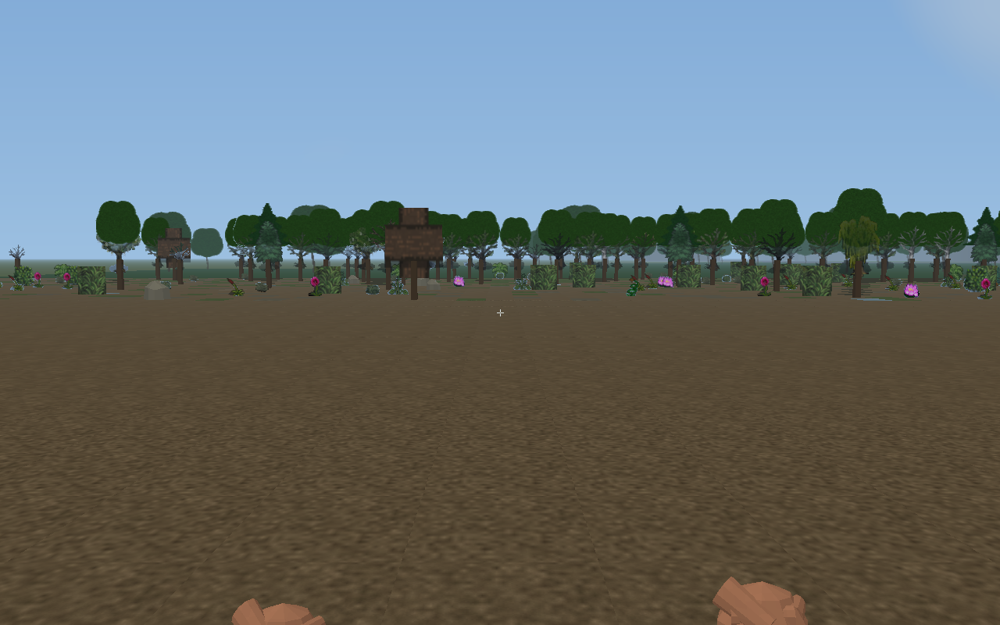
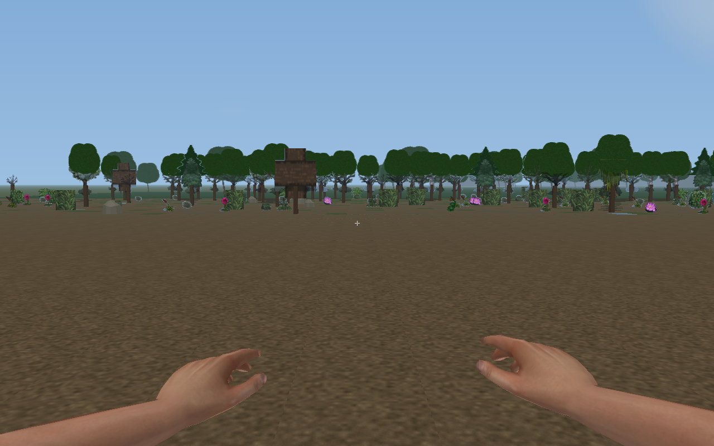
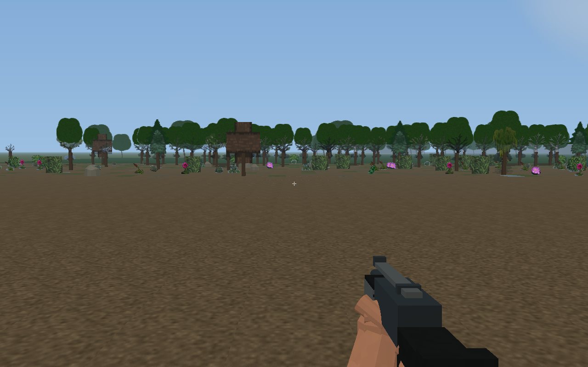
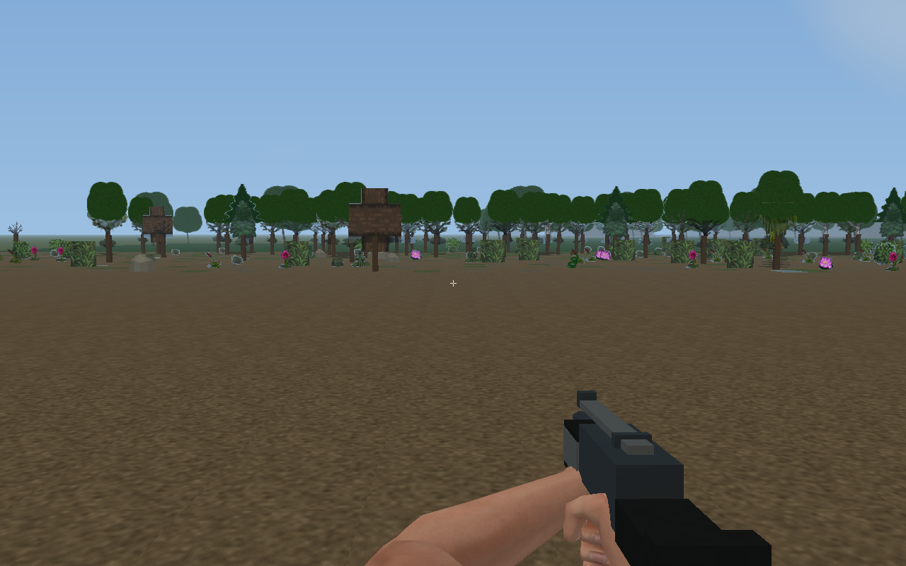

# First Person View 0.13: exact final installer QA

**Performance is not accepted; PR #218 remains Draft and is not merged.**

This evidence refers to frozen PR head 8d24cc2b8df4ccd6574e1f2f61108baf24f4bcf9, tested merge f9a6c95e9cff4edc51a92d63cac4fb98c8df4b3a and unchanged runtime inputs 3e9c8b065f23a73ae660dd028aab5dcc851df451. It does not qualify the rejected upload-split code on this evidence branch. No new runtime changes are included in the tested installer after its Full run.

[Full Qualification 39116354078](https://github.com/Neversalimus/NCMM/actions/runs/39116354078) and both exact packaged RTX4090/D3D12 native checks pass. Candidate and qualified inner ZIPs, Setup executables, Host/DLL and all 32 payload files are byte-identical. Both engine pins and 44 native inputs were verified. The ordinary certified feed and real player saves are unchanged.

## Exact final files: ordinary native frame controls

Original sourcec709 module / final PSX module / original module on the same final Host and 30 common payload files. These are normal unattached native runs without GPU debug: 12 records, 12 steps and 48 warm turns per record. The old module retains original hashing, so this is not isolated PSX or Host optimization cost. Identical old-module controls vary.

| GPU scene, viewport 1768x1084 | First median / p95 / p99 / max ms | Warm median / p95 / p99 / max ms |
| --- | ---: | ---: |
| street | 21.464 / 43.780 / 48.564 / 49.761 | 12.754 / 18.949 / 22.193 / 22.794 |
| multi_level_horde | 22.313 / 39.528 / 44.053 / 45.184 | 11.694 / 15.809 / 16.185 / 16.263 |
| city_blocks | 23.596 / 38.196 / 41.328 / 42.111 | 12.755 / 18.305 / 19.997 / 21.023 |

The 15ms objective is not demonstrated by these exact files. Twelve-step p99 is a coarse sample statistic, not reliable rare-tail evidence. Short native reports do not record internal raster dimensions; missing values remain unavailable. The older full R14 matrix records actual internal resolution, but its identical runtime inputs were compiled into different bytes and measured at different times. Its better 14-18ms development medians must not be represented as final-installer measurements.

## Completed native and visual qualification

The automated soak completed 1800.027779s and 25349 frames, with 396 F6 cycles, 264 F12 switches, 99 native map loads and 49 native saves. Ten actual native action groups and 24 paired CPU/GPU cases pass on official/UDP tilesets. This is not a manual playthrough.

All 108 Before plus 108 After captures were verified against exact binary identities and source RGB pixels. Codex visually inspected all 27 states across both renderers and tilesets in six contact sheets, plus nine full-resolution details. All 216 inspected BMP/RGB hashes match the final strict export. Full original PNGs and both local HTML galleries are retained in the task; only compact contact sheets and four selected original PNGs are published here.

The screenshots show actual CDDA SDL fixtures, not generated game pixels. Contact sheets are scaled previews. Source arms are Drillimpact 1.1.0 CC0; background game/tileset artwork retains its existing attribution and license.

| Bare hands before | Bare hands after |
| --- | --- |
|  |  |

| Rifle before | Rifle after |
| --- | --- |
|  |  |

[Official contact sheet](0.13.0-psx-final-8d24-contact-0.jpg) · [UDP contact sheet](0.13.0-psx-final-8d24-contact-1.jpg)

## GPU messages and memory

All four owned native debug logs have zero D3D12/DXGI ERROR/CORRUPTION severity messages. Warning IDs820/821 (optimized-clear metadata) and695 (empty scissor) also occur with the original module. No other warning classes were observed. This is not a zero-warning claim.

Whole-process RSS begin/end/peak: 1986404352/1712332800/2150834176 bytes. Logical renderer GPU peak: 30767160 bytes. The focused reports include actual DXGI process-local usage on both pinned builds; these differ from logical allocations and whole-process RSS and do not isolate PSX cost. CPU command-recording timers are not GPU execution timestamps.

## Remaining limits

The full R14 source comparison retains material ordinary-rotation regressions. The separate source5ae upload-split experiment was rejected after mixed exact-module controls and a complete four-way 80-record-per-variant comparison. It is absent from PR218. The private dynamic-mesh flag never shipped. The cause of every GPU/native wait was not isolated. Fur/scales/chitin/bionic finishes retain human PSX topology, and current Controls API lacks confirmed distinct use/reload events. No quality, distance, Z/LOD, visibility or simulation cuts were used.

[Exact package/QA identity](0.13.0-psx-final-8d24-hardware.json) · [All36 measurements](0.13.0-psx-final-8d24-measurements.csv) · [measurement scope](0.13.0-psx-final-8d24-measurements.json) · [ordered raw samples](0.13.0-psx-final-8d24-raw.json.gz) · [native GPU messages and memory](0.13.0-psx-final-8d24-gpu-debug.json) · [visual review](0.13.0-psx-final-8d24-visual-review.json) · [all216 capture identities](0.13.0-psx-final-8d24-gallery-manifest.json.gz) · [completed CI steps](0.13.0-psx-final-8d24-full-ci.json).

[Full R14 source measurements](0.13.0-psx-cells-r14-measurement-report.md) · [Rejected R19 full comparison](0.13.0-psx-split-r19-measurement-report.md) · [ordered R18/R19 controls](0.13.0-psx-upload-controls-r19.md) · [qualified-source asset/animation/API implementation](https://github.com/Neversalimus/NCMM/blob/8d24cc2b8df4ccd6574e1f2f61108baf24f4bcf9/experiments/FirstPersonView/VIEWMODEL.md).
